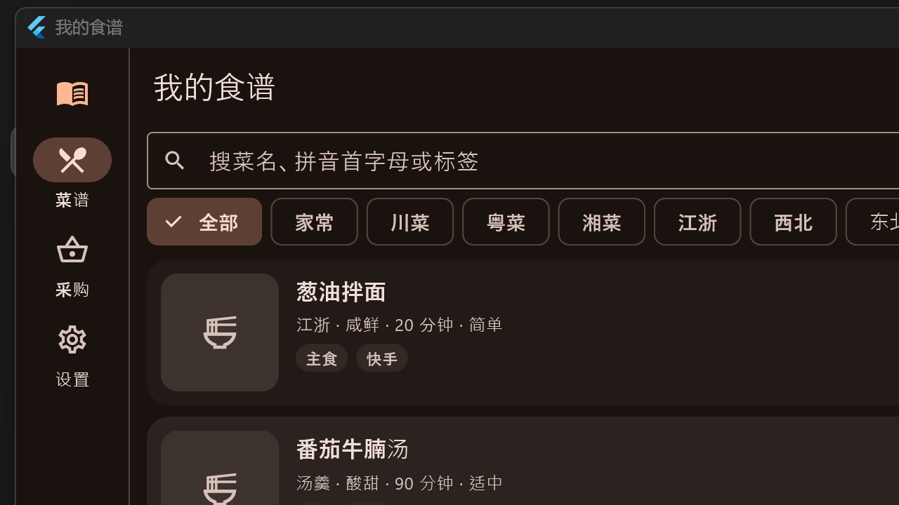

# 我的食谱 · Recipe Book

[](https://github.com/ztff/recipe_book/actions/workflows/build.yml)
[](https://github.com/ztff/recipe_book/releases)
[](LICENSE)

一款**完全离线**的本地菜谱应用：结构化食材、拼音首字母搜索、烹饪模式计时、采购清单自动合并。
一套 Flutter 代码同时构建 **Android** 与 **Windows 桌面**，无网络权限、无账号、无云同步，所有数据只存在你自己的设备上。



## 特性

- **结构化食材** — 每条食材 = 分组（主料 / 辅料 / 调料）+ 名称 + 数量 + 单位；支持「适量 / 少许」这类模糊量
- **分步做法** — 步骤可排序，每步可挂计时（1 分 ~ 20 分）
- **拼音首字母搜索** — 输入 `xhs` 直接命中「西红柿炒鸡蛋」；也能按食材名、标签反查
- **多维度筛选** — 菜系 / 口味 / 难度 / 用时四条固定维度 + 任意自由标签；按最近更新、做得多、用时短、评分高排序
- **烹饪模式** — 大字一屏一步、屏幕常亮、步骤计时器（响铃 + 震动），结束自动弹评分
- **桌面快捷键** — ↑↓ / ←→ 翻步骤，空格 开始·暂停计时，Esc 结束
- **采购清单** — 勾选多道菜，食材自动合并去重（克/千克、毫升/升 归一相加，模糊量归并）
- **做菜记录** — 做过几次、上次何时做的、最近评分，列表卡片直接显示角标
- **整库备份** — 数据库 + 全部图片打包成一个 zip，可导入回本机或换设备
- **开箱即用** — 首次启动自带 8 道示例菜，可一键重置或清空

## 安装

### Android

从 [Releases](../../releases) 下载对应 ABI 的 APK：

| 文件 | 适用 |
| --- | --- |
| `app-arm64-v8a-release.apk` | 绝大多数手机（推荐） |
| `app-armeabi-v7a-release.apk` | 较老的 32 位设备 |
| `app-x86_64-release.apk` | 模拟器 / x86 平板 |

安装时需允许「安装未知来源应用」。若系统提示风险，是因为该 APK 由本地构建、未走应用商店签名，属正常现象。

### Windows

下载 `recipe-book-windows-x64.zip`，解压后运行 `recipe_book.exe`。
整个文件夹要放在一起（exe 依赖同目录的 dll 与 `data` 目录）。

## 从源码构建

需要 Flutter 3.47+（Dart 3.13+）。Windows 端还需 Visual Studio 2022 的「使用 C++ 的桌面开发」工作负载。

```bash
flutter pub get

# 开发运行
flutter run -d windows
flutter run -d <android-device-id>

# 打包
flutter build windows --release      # build/windows/x64/runner/Release/
flutter build apk --release          # build/app/outputs/flutter-apk/
flutter build apk --release --split-per-abi   # 按 ABI 拆分，体积减半

# 测试
flutter test
```

Android 侧注意：本项目没有需要 NDK 编译的原生代码（SQLite 使用预编译库），
因此 `android/app/build.gradle.kts` 中没有强制 `ndkVersion`，可省去 2 GB 的 NDK 下载。

## 代码结构

```
lib/
  main.dart                        启动：数据目录自检、打开数据库、灌示例数据
  app.dart                         自适应外壳（手机底部导航 / 宽屏左侧栏）
  core/
    theme.dart                     Material 3 主题（浅/深色跟随系统）
    constants.dart                 菜系、口味、难度、单位、分组常量
    units.dart                     数量格式化 + 采购清单合并算法（有单测）
    pinyin.dart                    离线拼音首字母检索键
    pick_image.dart                拍照 / 相册 / 文件选图，复制进私有目录
    paths.dart                     数据目录解析（含多级兜底）
  data/
    db.dart                        手写 SQLite 层（sqlite3 + 变更广播）
    seed.dart                      示例菜谱与重置逻辑
    backup.dart                    zip 导出 / 导入
  features/
    recipes/                       列表、详情、编辑
    cook/                          烹饪模式
    shopping/                      采购清单
    settings/                      备份、重置、路径信息
test/widget_test.dart              合并算法与格式化的单元测试
```

## 数据与隐私

- 应用**不申请网络权限**（release APK 的 manifest 中没有 `INTERNET`），全部逻辑在本地完成
- 数据库是单个 SQLite 文件，图片存在同目录的 `images/`，路径在「设置 → 关于」里可见
- 备份包就是一个 zip，解压后是 `recipe_book.sqlite` + `images/`，可自行用任意工具读取
- 启动过程会写 `startup.log` 到程序目录，仅用于排查启动问题，可随时删除

## 已知限制

- 未实现「按人数自动换算份量」，目前按录入的份数显示原值
- 步骤排序使用上/下移按钮（拖动排序需要整页重构为 `ReorderableListView`）
- 导入备份后需重启应用才会读到新数据库（导入会关闭当前连接句柄）
- 首次进入时若无可用 GPU，Windows 版会因 Impeller 不支持软件渲染而启动失败

## 发布与签名

Release 里的 APK 使用项目自有的 keystore 签名（证书 `CN=YG, O=ztff`）。签名材料不入库：
`android/key.properties` 与 `*.jks` 均已写入 `.gitignore`。

CI（`.github/workflows/build.yml`）在推送 `v*` 标签时自动：

1. `flutter analyze` + `flutter test`
2. 构建 3 个 ABI 的 APK（用仓库 Secrets 里的 keystore 签名）
3. 构建 Windows 版并压缩成 zip
4. 用 `softprops/action-gh-release` 建 Release 并上传全部产物

需要的仓库 Secrets：

| 名称 | 内容 |
| --- | --- |
| `KEYSTORE_BASE64` | `base64 -w0 android/app/release-keystore.jks` 的输出 |
| `KEYSTORE_PASSWORD` | keystore 密码 |
| `KEY_PASSWORD` | key 密码 |
| `KEY_ALIAS` | key 别名（本项目为 `recipe`） |

Fork 后没配这些 Secrets 时，构建自动回退到 debug 签名（对应步骤会跳过），你自己的 fork 也能正常出包，
只是不能覆盖安装官方包。

**版本号规则**：`pubspec.yaml` 里的 `version: 1.0.1+2`，`+`
前是 versionName、后面是 Android versionCode；升级必须让 versionCode 递增，否则手机上无法覆盖安装。

## 贡献

欢迎 Issue 与 PR。提交前请确保：

```bash
flutter analyze    # 0 issues
flutter test       # 全部通过
```

## 许可证

[MIT](LICENSE) © 2026 YG
